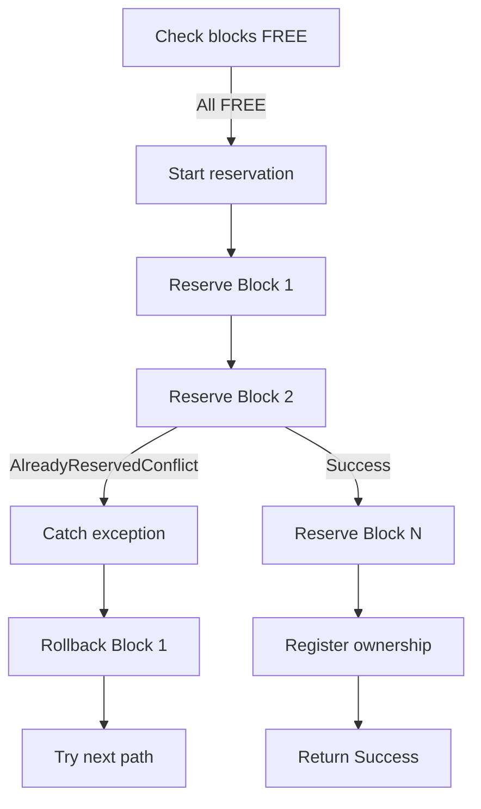
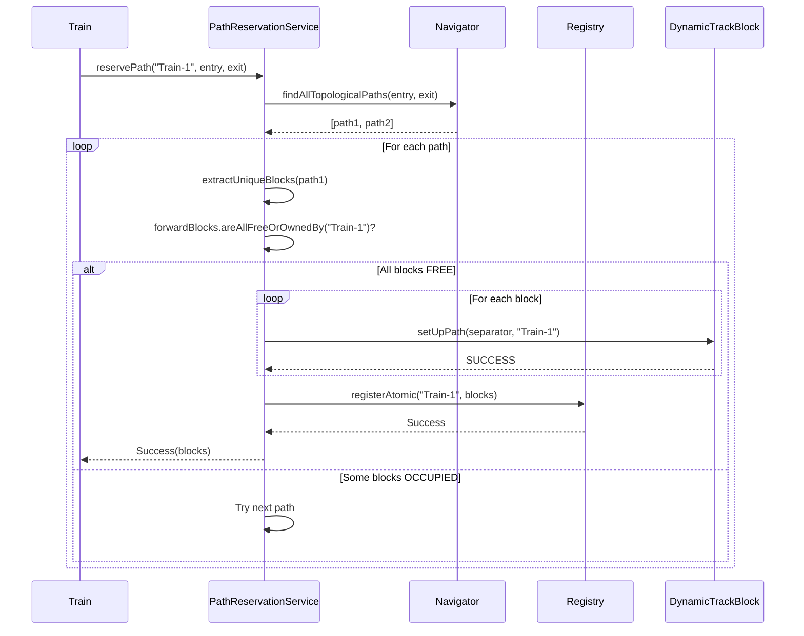
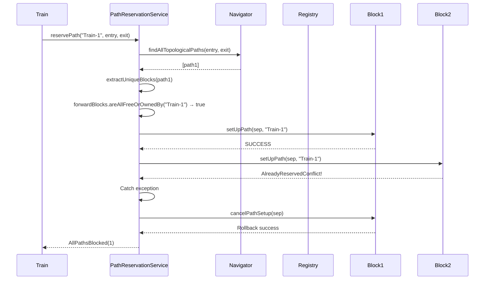
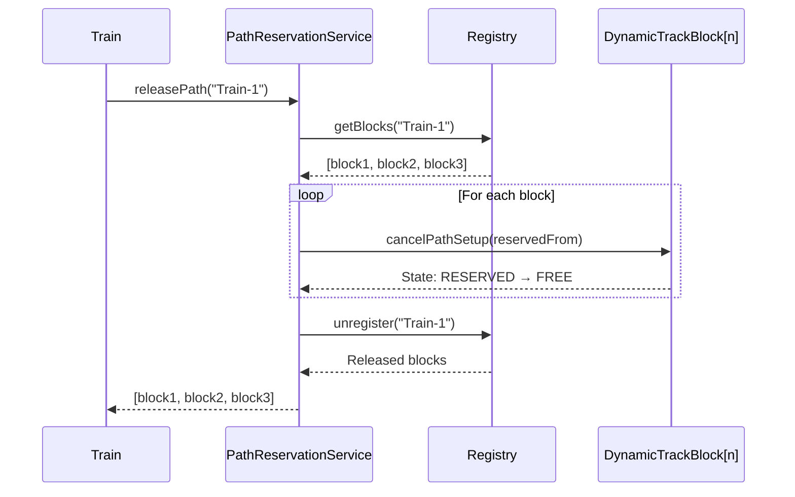
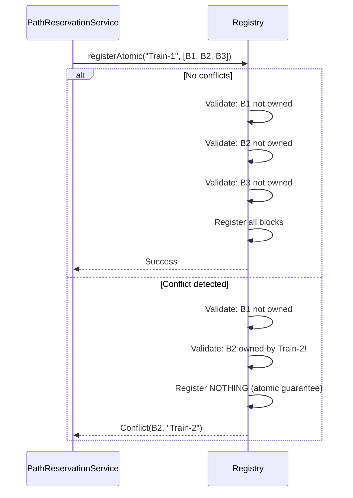
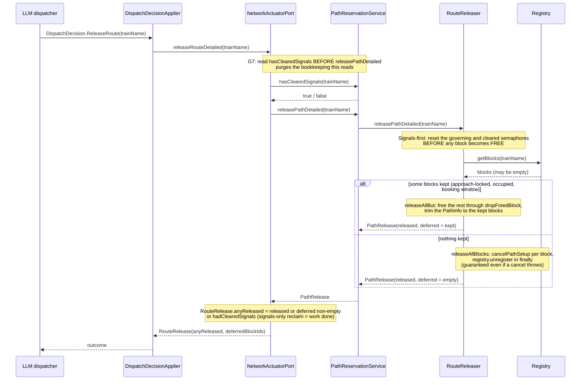

# Path Reservation Architecture

**Document Version:** 1.3
**Last Updated:** 2026-10-29
**Related Issues:** #292 Phase 2 Enhancement; #893 (signal-clearing invariants + contiguity); #896/#899 (route-release fixes)

## Table of Contents

1. [Overview](#overview)
2. [Component Responsibilities](#component-responsibilities)
3. [Reservation Algorithm](#reservation-algorithm)
4. [Error Handling Strategy](#error-handling-strategy)
5. [Signal-Clearing Invariants (Issue #893, G1–G7)](#signal-clearing-invariants-issue-893-g1g7)
6. [Cancel / Release Paths Taxonomy](#cancel--release-paths-taxonomy)
7. [TOCTOU Trade-Off Analysis](#toctou-trade-off-analysis)
8. [Design Decisions](#design-decisions)
9. [Sequence Diagrams](#sequence-diagrams)
10. [Future Considerations](#future-considerations)

---

## 1. Overview

The path reservation system enables trains to atomically reserve sequences of track blocks before physically entering them. This prevents deadlocks and ensures safe train movement through the railway network.

### Key Components

- **DefaultPathReservationService** - thin orchestrator behind `PathReservationService`; owns the candidate loop of `reservePath`, no state of its own
- **RouteCandidateScreen** - read-only screening: origin and end guards, rear-facing and divergent candidates
- **CandidateCommitter** - everything that mutates state for one candidate (Steps 2c-2i) and its scoped rollback
- **RouteReleaser** - every release and rollback path, including the approach-lock deferral window
- **ClearedSignalLedger** - which semaphore is lit for which train, and every reset back to STOP
- **RouteSignalConfigurator** - clears the START and intermediate semaphores of a reserved route
- **SwitchConfigurator** - sets, locks, registers and releases a candidate's switches
- **ReservationTargetDiscovery** - what a route can be set to, and in which order
- **ReservationContentionTracker** - blocked-request tracking and the one-shot conflict events
- **DefaultReservationExpiry** (with `TailStallTracker`) - kernel-side expiry of holdings that are not used
- **PathReservationRegistry** - ownership facade over `BlockOwnershipTable`, `SwitchOwnershipTable` and `PathInfoStore` / `PathInfoMerger`
- **TopologyNavigator** - static path finding
- **DynamicTrackBlock** - state machine and transitions

### Design Goals

1. **Atomic all-or-nothing reservation semantics** - Either all blocks reserved or none
2. **Early conflict detection** - Detect conflicts before committing to a path
3. **Clear separation of concerns** - Each component has single responsibility
4. **Single-threaded execution model** - No synchronization overhead

### High-Level Flow

```
Train requests path → Navigator finds routes → Service validates blocks
→ Service reserves blocks → Registry tracks ownership → Train enters path
```

---

## 2. Component Responsibilities

### PathReservationService

**Interface:** `cz.vutbr.fit.interlockSim.context.navigation.PathReservationService`
**Implementation:** `DefaultPathReservationService`

**Responsibilities:**
- Orchestrate path finding and reservation
- Validate block availability
- Atomically reserve blocks with rollback on failure
- Delegate ownership tracking to registry

**Key Methods:**
- `reservePath()` - Find and reserve free path
- `releasePath()` / `releasePathDetailed()` - Free the blocks of a train (the latter with approach locking)
- `isPathAvailable()` - Check availability (read-only)
- `getReservedBlocks()` - Query train ownership

**Design Principle:** Thin orchestrator. It wires the units listed under [Key Components](#key-components) and runs the candidate loop; the state lives in `ClearedSignalLedger`, `ReservationContentionTracker`, `RouteReleaser` (approach-lock deferral window) and `DefaultReservationExpiry`, plus the registry's tables.

### PathReservationRegistry

**Class:** `cz.vutbr.fit.interlockSim.context.navigation.PathReservationRegistry`

**Responsibilities:**
- Track bidirectional mapping: train ↔ blocks
- Detect conflicts (block already owned by different train)
- Provide atomic registration with all-or-nothing semantics
- Hold switch claims and the merged `PathInfo` per train

**Delegates:** the registry is a facade over three units, each owning its own maps.
- `BlockOwnershipTable` - the train ↔ block mapping (`trainToBlocks` / `blockToTrain`) and the registration times the expiry reads
- `SwitchOwnershipTable` - switch claims (`SwitchClaim`, including the flank marker) and stale-claim reclamation
- `PathInfoStore` with `PathInfoMerger` - the per-train `PathInfo`, merged on every extension

**Key Methods:**
- `registerAtomic()` - Atomic registration with conflict detection
- `unregister()` / `unregisterBlock()` - Remove all mappings for a train, or release one FREE block (reclaiming stale switch claims at its ends)
- `getOwner()` / `getBlocks()` - Query mappings
- `registerSwitches()` / `registerFlankSwitches()` / `reclaimStaleSwitchOwnership()` - Switch claims
- `registerPathInfo()` / `restorePathInfo()` / `trimPathInfoToHeldBlocks()` / `canTrimPathInfoTo()` - PathInfo merge, snapshot restore and tail trimming
- `expiredHoldings()` - Un-entered holdings older than the TTL, read by `DefaultReservationExpiry`

**Why Bidirectional?**
- O(1) conflict detection via the block → train map
- O(1) block release via the train → blocks map
- Memory overhead negligible for typical simulations

### TopologyNavigator

**Interface:** `cz.vutbr.fit.interlockSim.context.navigation.TopologyNavigator`
**Implementation:** `DefaultTopologyNavigator`

**Responsibilities:**
- Find all topological paths (BFS traversal)
- Navigate static topology only (no dynamic state)
- Provide paths as sequences of TrackSections

**Key Method:**
- `findAllTopologicalPaths(start, target, maxDepth)` - BFS path finding

**Design Principle:** Pure function (no side effects, no state changes)

### DynamicTrackBlock

**Class:** `cz.vutbr.fit.interlockSim.objects.tracks.DynamicTrackBlock`

**Responsibilities:**
- Manage block state machine (FREE → RESERVED → OCCUPIED → FREE)
- Track reservation ownership (trainId)
- Enforce state transition rules

**State Machine:**
```
FREE ----setUpPath()----> RESERVED ----enter()----> OCCUPIED
  ^                          |                          |
  |                          |                          |
  +------cancelPathSetup()---+                          |
  +------------------------leave()---------------------+
```

**Key Properties:**
- `trainName: String?` - Reservation ownership, the owning train's id (set during RESERVED and OCCUPIED)
- `occupant: TrackOccupant?` - Physical presence (only during OCCUPIED)
- `reservedFrom: PathSeparator?` - Reservation direction

**Why a String-based train id?** See [Design Decisions](#design-decisions)

---

## 3. Reservation Algorithm

### Step Overview

`DefaultPathReservationService.reservePath` is a thin loop; the KDoc of `reservePath` stays the detailed source. In order:

1. **Expiry at entry (Issue #1174).** The public overload first releases the stale holdings of *other* trains (`expireStaleReservations`). The internal overload that the `reservePathToAny` attempt loops call runs no expiry, so no expiry can move the snapshots their bypass rollback relies on.
2. **Step 0, three guards** (`RouteCandidateScreen`): a non-oriented start, a non-oriented target, and a start that is not contiguous with the train's footprint. Each rejects before anything is touched.
3. **Step 1, candidate discovery** (`findCandidatePaths`). No candidates means `NoPathExists`.
4. **Step 1.5, rear-facing ends (G8, Issue #1064)** and **Step 1.6, divergent candidates (Issue #1066)** are screened out before the loop and recorded as failures.
5. **Step 2, one pass per remaining candidate:**
   - 2a extract the unique blocks; 2a.5 drop the blocks this train already owns (`forwardBlocks`); a candidate that owns every block takes `reserveAlreadyOwnedPath`
   - 2b check that the forward blocks are FREE or owned by this train; otherwise remember the first blocked (block, owner) pair and try the next candidate
   - 2c reserve the forward blocks all-or-nothing (`CandidateCommitter.tryAtomicReservation`)
   - 2d to 2i hand the candidate to `CandidateCommitter.registerAndFinalizeCandidate`: register ownership, build the PathInfo, reclaim switch ownership, configure switches and the START signal, light the intermediate signals, merge the PathInfo
6. **After the loop**, `classifyExhaustedAttempt` turns the recorded failures into a result: `DivergesFromHeldRoute` or `GeometricallyImpossible` when every candidate failed permanently, otherwise `AllPathsBlocked(candidates)` with the contention recorded.

### Detailed Steps

#### Step 0: Endpoint Preconditions (Issues #1188, #1200)

**Methods:** `rejectNonOrientedStart(trainId, start, entryPoint)` and its END-side twin `rejectNonOrientedEnd(trainId, target, entryPoint)` (`RouteCandidateScreen`)

**Purpose:** Routes run signal-to-signal, so `start` must be an `OrientedPathSeparator` (a semaphore or an InOut). A switch is interior track, never an endpoint — the same invariant Issue #938 pinned for `PathInfo.start`. A non-oriented origin is rejected with `GeometricallyImpossible` **before** anything is touched, and `reservePathToAny` repeats the guard up front so the rejection is not re-derived once per candidate target. The twin applies the same rule to the target (Issue #1200): a route can only end at a semaphore or an InOut, because a train that held a route ending at a switch could never leave it (every extension from a switch is refused by the start guard).

**Why it must precede everything:** without it, a switch start passed Step 2c/2d (blocks reserved AND registered to the train) and only then threw `SimulationException[FATAL]` ("PathSeparator must be OrientedPathSeparator") out of `configureSwitchesInPath` → `DefaultSimulationContext.getSegment`, past every rollback path. The blocks stayed registered to a route that was never granted, so a later request from a separator that does not bound them was refused as `NonContiguousStart`. Pinned by `PathReservationNonOrientedOriginTest`.

#### Step 0: Contiguity Precondition (Issue #893, task A-R1)

**Method:** `RouteCandidateScreen.rejectNonContiguousStart(trainId, start)` (called from `DefaultPathReservationService.reservePath`)

**Purpose:** A route may only start where the train actually is. `[start]` must bound one of the blocks the train holds in the `PathReservationRegistry` or physically occupies; a failing request is rejected with `PathReservationService.ReservationResult.NonContiguousStart` **before** any candidate-path discovery (the Step 0 guards of `reservePath`), so it also governs the already-owned early-return branch.

**Exemption:** A train with no footprint at all (neither registered nor occupied blocks — still outside the network) is exempt; its route legitimately starts at an entry InOut.

**Split malformation coverage:** The queued-train half of the malformation (a route requested from a mid-station Signal for a train still queued for admission) has an empty footprint and passes vacuously here. It is guarded only at the tool layer by `RequestRouteTool.queuedOriginError`, which self-disables when that tool is built with no InOut-name set or with no `DispatchLoopSensorPort`. Callers reaching `reservePath` by any other route get no protection against the queued-train form. This split is a binding traffic-simulation-expert ruling, not an oversight: tightening the vacuous arm would reject every legitimate train-entry reservation.

**Why distinct from `AllPathsBlocked`:** `AllPathsBlocked` is ordinary contention — a caller should retry next tick. `NonContiguousStart` will never succeed while the train stays where it is; the caller (or the LLM dispatcher behind it) must ask for a different origin. Collapsing the two hides a dispatcher-output defect inside a routine-traffic counter.

#### Step 1: Path Discovery

**Method:** `findCandidatePaths(...)` in `DefaultPathReservationService`

**Sources, in order of precedence:**
- **InOut to InOut:** `RouteFinder.findRoutes`, cost-sorted, so the cheapest route is tried first.
- **Any other pair:** `TopologyNavigator.findAllTopologicalPaths(start, target, maxDepth)`, or the list the caller already enumerated (Issue #966), which the `reservePathToAny` attempt loop passes in so the paths are not enumerated twice.

**Output:** a list of paths (each path = list of TrackSections); empty if no topological route exists.

**Cost control:** the switch-constrained enumeration behind target discovery and `isPathAvailable` is bounded by a node budget and cached per navigator (`RouteSearch`, Issue #1151); it depends on the static topology only, never on block state.

#### Step 2a: Block Extraction

**Method:** `extractUniqueBlocks(path: List<TrackSection>)` — internal top-level helper in
`context/navigation/UniqueBlocks.kt`, shared with `MultiTrainLoop` (Issue #1123)

**Purpose:** Convert TrackSections to unique DynamicTrackBlocks

**Why Deduplication?**
- Switch "around" blocks appear twice in path definition
- We only want to reserve each physical block once

**Implementation:**
```kotlin
val seen = mutableSetOf<DynamicTrackBlock>()
return path.mapNotNull { section ->
    when (val block = section.getTrackBlock()) {
        is DynamicTrackBlock -> if (seen.add(block)) block else null  // Duplicate dropped silently
        else -> { logger.warn { "... context type mismatch." }; null }  // Wrong type: dropped, logged
    }
}
```

#### Step 2a.5: Owned-Block Filtering (Issue #296)

**Method:** `blocks.excludingOwnedBy(trainId)` yields `forwardBlocks`, the blocks this call must newly reserve.

**Why:** blocks the train already owns (OCCUPIED behind it, or RESERVED from an earlier separator) must not be re-reserved; doing so raised TOCTOU conflicts on route extensions. The same form is shared with the Step 1.6 probe.

**Already-owned candidate:** when `forwardBlocks` is empty the candidate takes `reserveAlreadyOwnedPath`. It only (re-)configures the START signal and registers or merges the PathInfo, and a redundant re-request for the route the train already holds is a no-op that still reports `Success` (Issues #296, #904).

#### Step 2b: Availability Check

**Method:** `forwardBlocks.areAllFreeOrOwnedBy(trainId)` (extension function)

**Checks:** every forward block is FREE or already owned by this train.

**Why Check Before Reserve?**
- Early rejection of blocked paths
- Avoids unnecessary rollback overhead
- Clear separation of validation and modification

**On failure:** the first blocked (block, owner) pair is remembered for the contention record, and the loop tries the next candidate.

**Trade-off:** TOCTOU window exists (see [TOCTOU Analysis](#toctou-trade-off-analysis))

#### Step 2c: Atomic Reservation

**Method:** `CandidateCommitter.tryAtomicReservation(trainId, separator, blocks)`

**Algorithm:**
```kotlin
val reservedSoFar = mutableListOf<DynamicTrackBlock>()
try {
    for (block in blocks) {
        block.setUpPath(separator, trainId)
        reservedSoFar.add(block)
    }
    return null  // Success
} catch (e: Exception) {
    return rollbackAndClassifyReservationFailure(separator, trainId, reservedSoFar, e)
}
```

**Atomicity Guarantee:**
- Either all blocks reserved, or none
- Any failure rolls the partial reservation back through `RouteReleaser.rollbackReservation`, which cancels a block only if it was reserved from this separator (`reservedFrom === separator`)

**Error Handling:** `rollbackAndClassifyReservationFailure` logs by exception type (`AlreadyReservedConflict` as a TOCTOU race, `InvalidStateTransition` as a state-machine violation, anything else as unexpected) and reports `AllPathsBlocked(1)` for the candidate, so `reservePath` tries the next one.

#### Step 2d: Ownership Registration

**Method:** `registry.registerAtomic(trainId, forwardBlocks)`, called from `CandidateCommitter.registerAndFinalizeCandidate`

**Purpose:** Track train ownership in registry

**Atomicity Guarantee:**
- Either all blocks registered, or none
- Conflict detection before registration

**Result Handling:** `Success` continues with Steps 2e-2i. `Conflict` rolls back only the forward blocks this call reserved, never the blocks the train already held (Issue #1025), emits the two conflict events and returns `Conflict(conflictingBlock, existingOwner)`, which ends the whole request.

**Why After Block Reservation?**
- Block state changes must precede registry updates
- Registry is metadata tracking, not primary state

#### Steps 2e-2i: Candidate Finalization (`CandidateCommitter`)

`registerAndFinalizeCandidate` runs these steps for a candidate that registered successfully. Every rollback is scoped to THIS candidate: the snapshots it needs (`priorSwitches`, `clearedBeforeCandidate`) are taken before the first mutation they guard, so the train's earlier hops (blocks, switches, signals, PathInfo) always survive.

| Step | Unit of work | On failure |
|---|---|---|
| 2e | Build the candidate's `PathInfo` with entry directions (`buildCandidatePathInfo`). | n/a |
| 2e.5 | Reclaim switch ownership (`reclaimCandidateSwitchOwnership`): release ORPHAN locks (a stray `setUpPath` that never reached `registerSwitches`, Issue #1065) and STALE foreign ownership (Issue #1076) among the candidate's switches, before they are configured. | n/a |
| 2f | Configure and register the candidate's switches (`configureAndRegisterSwitches`). Runs before the signals so the switches are in the right position. | `rollbackUnconfigurableCandidate`. `Unconfigurable` (Issue #742) is recorded as a permanent geometric failure; `Locked` (Issue #1065, SI-5) is transient contention (`AllPathsBlocked`). Try the next candidate. |
| 2g | Configure the START signal (`configureCandidateStartSignal`); an InOut START is driven by the forward blocks, a semaphore START by `blocks.first()`. | `rollbackFailedStartSignalCandidate`: record a G4 rejection as geometric, reset the candidate's cleared signals through `ClearedSignalLedger`, then `rollbackUnconfigurableCandidate`. Try the next candidate. |
| 2h | Light the intermediate semaphores along the path (`configureIntermediateSemaphores`); on a route extension only boundaries that lead into a new block. | n/a |
| 2i | Merge the forward-only PathInfo into the registry (`registerPathInfo`). Registration comes last, so no rollback path can leave a PathInfo for an unusable route behind. | `rollbackIfMergeAborted`: reset the candidate's signals and roll the candidate back (Issue #904). Try the next candidate. |

After 2i the committer emits `BlockReserved` only for the forward blocks (Issue #1081), clears the train's blocked-contention record and returns `Success(blocks)`.

---

## 4. Error Handling Strategy

### Exception Hierarchy

```
TrackReservationException (sealed class)
├── AlreadyReservedConflict
└── InvalidStateTransition
```

**Benefits of Sealed Class:**
- Compile-time exhaustive checking
- Type-safe error classification
- Structured error data (no string parsing)

### Error Classification

| Exception Type | Scenario | Recovery Strategy | Severity |
|---|---|---|---|
| **AlreadyReservedConflict** | Block reserved from different separator (TOCTOU race) | Try next path in list | Low |
| **InvalidStateTransition** | State machine violation (programming error) | Try next path, log error | Medium |
| **RegistrationResult.Conflict** | Registry detects ownership conflict | Rollback blocks, return Conflict | Medium |
| **NoPathExists** | No topological route (disconnected network) | Report to caller | High |
| **NonContiguousStart** | Start separator bounds none of the train's blocks (Issue #893, A-R1); will never succeed while the train stays where it is | Caller must request a different origin; do NOT retry the same start | High |
| **GeometricallyImpossible** | The request can never succeed as asked: non-oriented start or end, or EVERY candidate failed geometrically (rear-facing START or END, unconfigurable switch; Issues #903, #937, #1188, #1200) | Caller must not retry the same request; a mix with a merely busy candidate stays `AllPathsBlocked` | High |
| **DivergesFromHeldRoute** | Every candidate leaves the route the train already holds (Issue #1066) | Extend from the held target or cancel the route first | Medium |

### Handling Guidelines

#### AlreadyReservedConflict

**Scenario:**
```kotlin
// Block was FREE during check, but became RESERVED before reservation
if (forwardBlocks.areAllFreeOrOwnedBy(trainId)) {  // Check: all FREE
    // ... Time passes ...
    block.setUpPath(separator)  // Reserve: throws AlreadyReservedConflict!
}
```

**Recovery:**
```kotlin
catch (e: TrackReservationException.AlreadyReservedConflict) {
    logger.warn { "TOCTOU race: Block ${e.block} reserved by ${e.existingSeparator}" }
    // Rollback partial reservation
    rollbackReservation(separator, reservedSoFar)
    // Try next path
    continue
}
```

**Expected Frequency:** Rare (single-threaded model), but possible with complex interlocking logic

#### InvalidStateTransition

**Scenario:**
```kotlin
// Attempt illegal transition (e.g., OCCUPIED → RESERVED)
block.setUpPath(separator)  // Block is OCCUPIED, throws InvalidStateTransition
```

**Recovery:**
```kotlin
catch (e: TrackReservationException.InvalidStateTransition) {
    logger.error(e) { "State violation: ${e.operation} from ${e.fromState}" }
    // Rollback and try next path
    rollbackReservation(separator, reservedSoFar)
    continue
}
```

**Expected Frequency:** Should never happen (indicates programming bug)

#### RegistrationResult.Conflict

**Scenario:**
```kotlin
// Block reservation succeeded, but registry detects conflict
// (Different train already registered the block)
when (val result = registry.registerAtomic(trainId, blocks)) {
    is Conflict -> {
        logger.warn { "Registry conflict: ${result.conflictingBlock} owned by ${result.existingOwner}" }
        rollbackReservation(separator, blocks)
        return Conflict(result.conflictingBlock, result.existingOwner)
    }
}
```

**Expected Frequency:** Should never happen (indicates programming bug or race condition)

---

## 5. Signal-Clearing Invariants (Issue #893, G1–G7)

**Contract** (pinned by `PathReservationSignalReleaseTest`): *a proceed aspect may not outlive the reservation that produced it.* Every release path resets the train's cleared signals to STOP before any block becomes FREE/available to another train. Until the #893 fix, `releasePath` and `unregister` cancelled blocks and unlocked switches but never touched a semaphore, so every aspect they cleared stayed lit forever — observed live on `exampleGui shuntingLoopAI 333`, where an `A → B` route granted at t=26.0 cleared `zA`, `doA1`, `doB1`; the `OrphanReservationSweeper` cancelled the stale route at t=88.0; all three were still showing S80 at the end of the run. `Signal.STOP` is always the fail-safe direction: it authorises nothing, so resetting too eagerly can only ever be over-restrictive.

### G1–G7 Invariant Table

| G | Invariant | Task | Source |
|---|-----------|------|--------|
| G1 | A partial (tail) route release must reset the governing semaphores of every released block through the ownership-aware `resetSemaphoresForReleasedBlocks`, not just `reservedFrom as? DynamicRailSemaphore`. | A3 | `PathReservationService.resetSemaphoresForReleasedBlocks`; impl `ClearedSignalLedger.resetSemaphoresForReleasedBlocks` |
| G2 | `unregisterBlock` (per-block tail-clearance) must return the released block's governing semaphores to STOP, not just update the registry. | A4 | impl `RouteReleaser.unregisterBlock` (the semaphore reset runs before `registry.unregisterBlock`, and `emitBlockReleased` comes last) |
| G3 | A signal-config failure in `reservePath` Step 2g must undo any PARTIAL aspect write (START may be physically lit though `recordClearedSemaphore` never ran) via `resetSemaphoreSet` + `resetUnrecordedStartSignal`. | A5 | `CandidateCommitter.configureCandidateStartSignal`, undo in `CandidateCommitter.rollbackFailedStartSignalCandidate` (through `ClearedSignalLedger.resetCandidateSignals`); resets in `ClearedSignalLedger.resetSemaphoreSet` / `resetUnrecordedStartSignal` |
| G4 | A route whose START semaphore faces AWAY from the requested direction must be rejected outright (a rear-facing START grants no proceed authority — a #566-class stall). | A1 | `RouteSignalConfigurator.configureStartSignal` (the G4 guard, `StartSignalResult.RejectedG4`) |
| G5 | `DispatchDecision.SetSignalAspect` carries an optional `trainName`; `DefaultNetworkActuatorPort.setSignalAspect` has an attributed 3-arg overload recording through the same single ledger — closing the tracking-contract hole for any future caller. (Attribution-only; no live behaviour change.) | A6 | PR #899 (squash `8082f900`) |
| G6 | Every cleared signal — including ones written by external paths (`DefaultInterlockingFacade.clearSignal`, the facade's block-list `requestRoute`) — must be folded into the single service ledger (`recordExternalClearedSemaphore`) so a later `releasePath`/sweeper reset can find and drop it. | A6 | `PathReservationService.recordExternalClearedSemaphore`; impl `DefaultPathReservationService.recordExternalClearedSemaphore` (delegates to `ClearedSignalLedger`) |
| G7 | `releasePath` must reset a train's cleared signals BEFORE its `blocks.isEmpty()` early return, and `releaseRoute` must report truthfully (via `hasClearedSignals`) when a train holds cleared signals but zero blocks — a signals-only reclaim counts as work done. | A7 | impl `RouteReleaser.release` (the signal reset runs before the empty-blocks early return), `PathReservationService.hasClearedSignals` |
| G8 | A route whose END semaphore faces AWAY from the direction of travel at arrival must be rejected before any block, switch or signal is touched (a rear-facing end leaves the train standing at its last facing signal, holding track it cannot use — the #1031/#1060 stall). InOut ends are exempt; the direction is judged per candidate at the target's own cell. Recorded as a geometric failure, so a request whose every candidate ends rear-facing is `GeometricallyImpossible`. | #1064 | `RouteCandidateScreen.rearFacingEndReason` (`reservePath` Step 1.5) |
| G9 | Safety property SI-5: `DynamicRailSwitch.setUpPath` must never move a switch that is locked in a DIFFERENT position — a live route's own switch lock is authoritative, the same way `changeConf` already honours it. A candidate that needs the other position throws `SwitchLockedException`, caught before configuration touches `conf` or `locked`. Unlike G4/G8, this is TRANSIENT contention (`AllPathsBlocked`), never `GeometricallyImpossible` — the switch frees once its holder's route releases it, and misclassifying it would make `InOutWorker` throw instead of letting the train wait (the #1031 stall's root cause: `configureSwitchesInPath` silently re-threw a live route's switch, corrupting it before the Step 2i merge-abort rollback ever ran). A companion reclamation (`PathReservationRegistry.unregisterBlock` → `SwitchOwnershipTable.reclaimStaleSwitchOwnership`, since #1103) releases a switch lock once its owner holds no block adjacent to it, with a reclaim failure contained there, so a train that has merely PASSED a switch does not block every other train forever. | #1065 | `DynamicRailSwitch.kt` `setUpPath`; `SwitchConfigurator.kt` `configureSwitchesInPath`/`SwitchConfigOutcome`; `PathReservationRegistry.kt` `unregisterBlock`/`reclaimStaleSwitchOwnership` |
| G10 | Switch ownership is never overwritten: `PathReservationRegistry.registerSwitches` rejects a switch registered to a DIFFERENT train atomically (pre-scan before any mutation), so `switchToTrain` and `trainToSwitches` can never disagree about the owner. A candidate that needs such a switch even in the SAME position is refused as transient `Locked` contention (`AllPathsBlocked`) — but only when the required configuration is known, so a #742 geometric impossibility still classifies as `Unconfigurable`. STALE foreign ownership (owner holds no adjacent block) cannot survive a block release: `PathReservationRegistry.unregisterBlock` reclaims it at the freed block's ends on every release path, including a direct registry call (#1103 item 1). The only way a stale claim can still arise is the public `registerSwitches` taken with no adjacent block held; `reservePath` Step 2e.5 reclaims that one before the candidate takes the switch. Facade flank grants (`registerFlankSwitches`) are never stale, since a flank switch protects a route it is not adjacent to (see `INTERLOCKING_SCOPE_LIMITATIONS.md` §B2). | #1076, #1103 | `PathReservationRegistry.registerSwitches`/`isStaleSwitchOwnership`/`unregisterBlock`/`reclaimStaleSwitchOwnership`; `SwitchConfigurator.kt` `switchOwnershipPreCheck`/`reclaimStaleForeignSwitchOwnership` |

**Malformation class note:** G4 (rear-facing START rejection), G8 (rear-facing END rejection) and the contiguity precondition (A-R1, [Step 0](#step-0-contiguity-precondition-issue-893-task-a-r1)) are the same malformation class — a route the train cannot actually use (`PathReservationStartDirectionTest`). G9 is explicitly NOT in that class: a G9 refusal is ordinary, resolving contention over a shared switch, not a route the train can never use.

### Ownership-Aware Reset APIs

Three ownership-aware APIs underpin G1–G7. All share a single cleared-signal ledger (`clearedSemaphores` / `semaphoreClearedFor`) maintained by `ClearedSignalLedger.recordClearedSemaphore`.

#### `resetSemaphoresForReleasedBlocks(trainId, blocks)`

- **Interface:** `PathReservationService.resetSemaphoresForReleasedBlocks`
- **Impl:** `ClearedSignalLedger.resetSemaphoresForReleasedBlocks` (the service's override delegates)
- **Candidate signal sources:** `block.ends()` (intermediate semaphore or InOut's `inSemaphore`) + `block.reservedFrom` (route START incl. InOut's `inSemaphore`). Both sources are needed because `reservePath` sets every reserved block's `reservedFrom` to the ROUTE-START separator, so for a multi-block route only the first block's `reservedFrom` is genuinely adjacent — `ends()` recovers the correct intermediate boundary for later blocks, and `reservedFrom` recovers the START itself (including the InOut case).

#### `hasClearedSignals(trainId)`

- **Interface:** `PathReservationService.hasClearedSignals`
- **Impl:** `ClearedSignalLedger.hasClearedSignals` (`= clearedSemaphores.containsKey(trainId)`; the service's override delegates)
- **Purpose:** Read by `DefaultNetworkActuatorPort.releaseRouteDetailed` (which `releaseRoute` delegates to) BEFORE `releasePathDetailed` purges the bookkeeping this reads — so a signals-only release can be reported truthfully instead of being masked as "nothing happened" (G7).

#### `recordExternalClearedSemaphore(trainId, semaphore)`

- **Interface:** `PathReservationService.recordExternalClearedSemaphore`
- **Impl:** `DefaultPathReservationService.recordExternalClearedSemaphore`
- **Purpose:** The G6 single-signal-ledger entry point for external paths. Delegates to the same `recordClearedSemaphore` used internally by `reservePath`, so an external caller's write is folded into the single ledger this service already maintains. Without it, a facade-granted entry signal stayed lit forever after a sweep.

### Proven-Safe Scope (suffix/rearmost releases only)

The reset is **proven safe only for suffix / rearmost releases on a non-revisiting route** (the `PathReservationService.resetSemaphoresForReleasedBlocks` KDoc); NOT for an arbitrary mid-route subset, because the semaphore governing a released block can also be the one a still-reserved downstream block on the same route depends on (an intermediate boundary shared with a block further along). A route that loops back and becomes adjacent to a released block again has the same exposure: the semaphore this call resets may be the one that governs re-entry into the loop.

**Failure direction is fail-safe:** `Signal.STOP` authorises nothing, so the worst outcome of an over-eager reset outside the proven-safe scope is a train stalled behind a signal it still needed — never a train permitted to move where it should not be.

The impl performs no route-position validation of its own; the caller is responsible for staying within the proven-safe scope (the same interface KDoc). See also [INTERLOCKING_SCOPE_LIMITATIONS.md](INTERLOCKING_SCOPE_LIMITATIONS.md) §B5 (revisiting / circular-route caveat).

### Ownership-Aware Last-Writer-Wins Reset

A semaphore that has since been re-cleared for a DIFFERENT train is left alone by a later release. This is **single-threaded sequential ownership hygiene** (the simulation is single-threaded — kDisco runs one sim thread), not a concurrency guard. Backed by the `semaphoreClearedFor` map:

- `recordClearedSemaphore` records `semaphoreClearedFor[semaphore] = trainId`.
- `resetClearedSemaphores` skips when `semaphoreClearedFor[semaphore] != trainId`.
- `resetSemaphoreSet` applies the same guard.

**Test:** `PathReservationSignalReleaseTest` — *"resetSemaphoresForReleasedBlocks leaves a since re-cleared semaphore alone, and a later releasePath does too"*. After `t2` re-clears a semaphore `t1` released, a stale `resetSemaphoresForReleasedBlocks("t1", ...)` and a subsequent `releasePath("t1")` both leave `t2`'s live signal untouched.

---

## 6. Cancel / Release Paths Taxonomy

**Invariant: signals-first-blocks-second** — every full/partial release resets the train's cleared signals to STOP before any block becomes FREE/available to another train. A block must never become available to another train while the semaphore that authorises entry to it still shows proceed.

> **Scope note (*storno* vs *uvolnění*):** real railways distinguish *storno* (cancel before occupancy: dispatcher command, signal→Stop, then a mandatory time-release timer before the *závěr* frees) from *uvolnění* (release after occupancy: automatic/progressive behind the train). The simulator conflates both into the single release path below and has no approach-locking timer — acceptable because entry is gated on reservation, not signal-sighting (see [INTERLOCKING_SCOPE_LIMITATIONS.md](INTERLOCKING_SCOPE_LIMITATIONS.md) §B1 for the full safety argument).

There are nine release paths:

| # | Call site | Location | Role | Signals-first? |
|---|-----------|----------|------|----------------|
| 1 | `releasePath` | `RouteReleaser` (extracted SP12.2, PR #1194; the service delegates) | Full-route release. Signals reset (the `resetSemaphoresForReleasedBlocks` and `resetClearedSemaphores` callbacks) before the empty-blocks early return and before the per-block `cancelBlock` loop; `registry.unregister` in the `finally`. | Yes (self-enforced) |
| 2 | `unregister` | `RouteReleaser` (same extraction) | Production train-completion path (`Train → releaseTrainReservations`). Reset first, then the per-block `cancelPathSetup` loop, switch unlock AFTER block cancellation (matching the release order — a switch is unlocked only once nothing it protects is still RESERVED), `registry.unregister` last. **F1 fix (PR #901, squash `0d348f2b`):** the per-block `cancelPathSetup` loop was ADDED so a journey completing with RESERVED-but-never-entered blocks (bidirectional reversal / abandoned extension) no longer leaves orphan RESERVED blocks. Previously `registry.unregister` only removed ownership maps and `emitBlockReleased` hardcoded `newState=FREE`, masking the state/event divergence. Mirrors the `cancelBlock` loop of `releaseAllBlocks`. | Yes (self-enforced) |
| 3 | `unregisterBlock` | `RouteReleaser` (same extraction) | Production per-block tail-clearance (`Train.Tail.separatorAction`). **F2 fix (PR #901, squash `0d348f2b`):** the release preconditions (block owned by this train, unoccupied, FREE) are checked FIRST (PR #1068 review); a block that fails them is not released and no signal is touched, since its boundaries are not known to be behind the train's head. Only then does `resetSemaphoresForReleasedBlocks(trainId, listOf(block))` run, BEFORE `registry.unregisterBlock` and `emitBlockReleased`, so there is no instant where a block is owner-less-and-FREE while its authorising signal still shows proceed. | Yes (self-enforced) |
| 4 | bypass-rollback | `DefaultPathReservationService.releaseBypassRollbackBlocks` (private helper; call site `reservePathToAnyNextSemaphore`) | Releases the wrongly-reserved path when the reserved path doesn't use the required `next` block. Per-block `cancelPathSetup` with `registry.unregisterBlock` in `finally` (**F3 fix**: `finally` so a `cancelPathSetup` throw no longer leaks a registered block; uses `block.reservedFrom`). Signals reset done by the caller in `reservePathToAnyNextSemaphore` before the helper. **PR #901 review — transactional completion:** the same reject branch also undoes the candidate's switch registrations/locks (registry delta vs the pre-attempt snapshot, released via `SwitchConfigurator.releaseCandidateSwitches`) and restores its merged `PathInfo` to the pre-attempt snapshot via `PathReservationRegistry.restorePathInfo`, so a rejected alternative no longer leaves track locked or navigation metadata pointing through a released route. | Caller-enforced |
| 5 | `rollbackUnconfigurableCandidate` | `CandidateCommitter` (extracted SP12.10, `internal`) | Rolls back a candidate whose switches (Step 2f) or START signal (Step 2g) couldn't be configured -- now two switch-configuration causes, Unconfigurable (#742) and Locked (#1065, SI-5), sharing this one rollback. Scoped to the candidate's own mutations (no `registry.unregister(trainId)`); candidate-only switch release delegated to `SwitchConfigurator.releaseCandidateSwitches` (which releases only switches owned by this train or by NO train -- a switch registered to another train keeps both its lock and its registry entry, Issue #1065 review); each fresh block goes through `RouteReleaser.rollbackBlock` (cancel, then `registry.unregisterBlock`, Issue #961). Signal-config-failure (G3) reset done by the caller in Step 2g. Neither `releaseCandidateSwitches` nor any other rollback path restores a released switch's *position* (only its lock) -- sound since Issue #1065's G9 guard means the position was never wrongly written in the first place; a rolled-back candidate's own newly-locked-then-unlocked switches carry no authority once unlocked, so their leftover position is harmless. | Caller-enforced |
| 6 | `releaseUntravelledTail` | `PartialRouteReleaser` (interface, `dispatcher-agent`), impl `RegistryPartialRouteReleaser` | Releases the un-travelled tail of a stalled reservation while leaving the occupied block registered. Resets first: `resetSemaphoresForReleasedBlocks(trainId, eligible)` BEFORE any release, and an approach-locked tail (a proceed aspect stood between head and tail) is only reset and deferred to the next sweep. Then each block goes through `PathReservationService.releaseBlock` (Issue #961); `registry.unregisterBlock` runs only as the last-resort fallback for a FREE block the service did not finish unregistering. Caller `OrphanReservationSweeper` (the stalled-tail sweep). | Yes (self-enforced) |
| 7 | `releasePathDetailed` → `releaseAllBut` | `RouteReleaser` | Approach-locked whole-route release (Issues #1050, #1242; the production `cancel_route` and sweeper path). Resets all the train's signals first, then frees every block except the kept ones (approach-locked, occupied, or inside the deferral window), each through `dropFreedBlock`, never `registry.unregister`; the kept blocks stay RESERVED and registered, the PathInfo is trimmed to what the train holds, and the call returns `PathRelease(released, deferred)`. A release whose PathInfo cannot be trimmed is refused before any signal or block changes. | Yes (self-enforced) |
| 8 | `releaseBlock` / `rollbackBlock` | `RouteReleaser` (`BlockReleaseSteps`, `BlockRollbackStep`, Issue #961) | The single-block steps for callers outside the registry: ownership check first, then `cancelPathSetup`, then `registry.unregisterBlock` and the release event. `releaseBlock` goes through `unregisterBlock` (and so resets the governing signal); `rollbackBlock` is the never-announced rollback of a candidate's fresh block and resets nothing, its callers run before any signal is lit. | `releaseBlock`: yes; `rollbackBlock`: caller-enforced |
| 9 | `DefaultReservationExpiry.expireStale` | `DefaultReservationExpiry` (Issue #1174), triggered at the entry of `reservePath` / `reservePathToAny` and by the loop tick (`ReservationExpiry`) | Kernel-side expiry of a holding that is not being used: a stale whole-route holding (all blocks RESERVED, none entered, older than the TTL) and the stalled tail of a train on the track. Both release through `releasePathDetailed`, so row 7's approach locking applies and a deferral is retried on the next call. | Yes (via row 7) |

**Summary:** `releasePath`, `unregister`, `unregisterBlock`, `releasePathDetailed`, `releaseBlock`, `releaseUntravelledTail` and the expiry (through `releasePathDetailed`) enforce signals-first-blocks-second themselves; the rollback helpers (rows 4, 5 and `rollbackBlock`) handle a never-granted candidate and rely on their caller (Step 2g / the bypass path) to reset signals.

**Switches-last addendum (Issue #1065, moved into the registry by Issue #1103):** `PathReservationRegistry.unregisterBlock` -- the single funnel for **per-block** releases (`RouteReleaser.dropFreedBlock` and `rollbackBlock`, and `RegistryPartialRouteReleaser`'s last-resort direct fallback, all end here; the whole-route rows 1-2 above are the exception: `releasePath` and `unregister` go through `registry.unregister(trainId)`, which releases the train's held switch claims wholesale itself (its callers' `unregisterSwitches(trainId)` pairs then no-op idempotently)) -- reclaims a stale switch claim once its owner holds no block adjacent to it (`reclaimStaleSwitchOwnership`), so the invariant "no stale switch ownership" holds after every per-block release and after a whole-route teardown too; a reclaim failure is contained there too (logged, `null` returned, the stale claim stays healable -- a retry finds the switch already unlocked and cleans the maps). That catch is defense-in-depth: the primary containment for a throwing `DynamicRailSwitch` property listener lives in the cell itself (`DynamicRailSwitch.notifyListeners` -- logged there, later listeners still notified, the lock state change still completes), so the release funnel only rarely sees a throw at all (the PR #1144 review's ruling C). This keeps a G9 refusal (above) from turning a train that has merely PASSED a switch into a permanent block for every other train: without it, a switch stayed locked from reservation until the owner's FULL journey completion (`unregister`'s unconditional unlock), confirmed to happen on every repetition of the vyhybna shunting loop. Since Issue #1076 the staleness rule lives in one place (`PathReservationRegistry.isStaleSwitchOwnership`, which also exempts flank-protected switches), shared by this release-time reclamation and the reservation-time `reclaimStaleForeignSwitchOwnership` (Step 2e.5, G10), which since #1103 only has to catch a claim made through the public `registerSwitches` with no adjacent block held.

---

## 7. TOCTOU Trade-Off Analysis

### Problem Description

**TOCTOU (Time-Of-Check-Time-Of-Use)** race condition exists between:

1. **Check:** `if (!forwardBlocks.areAllFreeOrOwnedBy(trainId))` (in `DefaultPathReservationService.reservePath`)
2. **Use:** `tryAtomicReservation()` (called from `reservePath`; implemented in `CandidateCommitter`)

**Window:** Small time gap where block state could change.

### Scenario Example

```
Thread/Process 1 (Train A):
    t0: Check blocks [B1, B2, B3] → all FREE
    t1: Reserve B1 → SUCCESS

Thread/Process 2 (Train B):  [HYPOTHETICAL - system is single-threaded]
    t1.5: Reserve B2 → SUCCESS  [Would require multi-threading]

Thread/Process 1 (Train A):
    t2: Reserve B2 → AlreadyReservedConflict!
    t3: Rollback B1
```

### Why Acceptable in Current System

#### 1. Single-Threaded Execution

**Current Model:** kDisco discrete event simulation runs in single thread.

**Implication:** No concurrent reservations possible.

**Evidence:** All simulation processes (Train, InOutWorker, Generator) execute sequentially.

#### 2. Atomic Rollback

**Detection:** `AlreadyReservedConflict` exception thrown during reservation.

**Recovery:** Immediate rollback of partial reservation.

**Guarantee:** System never left in inconsistent state.

#### 3. Worst Case is Acceptable

**Failure Mode:** False positive (path appears free but isn't).

**Consequence:** Try next path in candidate list.

**Impact:** Minimal performance penalty (one extra path attempt).

### Detection and Recovery Flow



### Future Multi-Threading Considerations

If simulation engine is migrated to multi-threaded execution, synchronization required:

#### Option 1: Block-Level Locking

```kotlin
synchronized(blocks) {
    if (forwardBlocks.areAllFreeOrOwnedBy(trainId)) {
        tryAtomicReservation(blocks, trainId, separator)
    }
}
```

**Pros:** Fine-grained locking
**Cons:** Lock contention, deadlock risk

#### Option 2: Global Reservation Lock

```kotlin
private val reservationLock = ReentrantLock()

fun reservePath(...): ReservationResult {
    reservationLock.withLock {
        // Entire reservation algorithm
    }
}
```

**Pros:** Eliminates TOCTOU, simple to reason about
**Cons:** Serializes all reservations, performance bottleneck

#### Option 3: Optimistic Locking (Recommended)

```kotlin
// Keep current TOCTOU model, rely on exception-based rollback
// Multi-threaded performance tests show acceptable contention rates
```

**Pros:** No lock overhead, good parallelism
**Cons:** Retry overhead on contention

### Decision: Keep Current Model

**Rationale:**
1. Single-threaded execution makes TOCTOU extremely rare
2. Exception-based rollback is clean and testable
3. No performance penalty in current system
4. Easy to add synchronization later if needed

**Documentation:** This trade-off is clearly documented for future maintainers.

---

## 8. Design Decisions

### String-Based Train IDs vs Object References

**Decision:** Use `String trainId` instead of `TrackOccupant` references in registry and block state.

**Rationale:**

#### 1. Early Reservation Support

**Requirement:** Reserve path before train object exists.

**Example:**
```kotlin
// Generator creates train AFTER path is reserved
val result = reservationService.reservePath("Train-${nextId++}", entry, exit)
if (result is Success) {
    val train = Train(trainId, entry)  // Create train object now
}
```

**Alternative (rejected):** Use dummy train objects → unnecessary complexity.

#### 2. Registry Decoupling

**Benefit:** Registry doesn't need full object graph references.

**Simplification:**
```kotlin
// With String IDs:
val owner = registry.getOwner(block)  // Returns "Train-123"

// With Object references (rejected):
val owner = registry.getOwner(block)  // Returns Train instance
val ownerId = owner.toString()  // Extra indirection
```

#### 3. Clearer Logging

**With String IDs:**
```
[INFO] Block reserved by Train-123
[WARN] Conflict: Block owned by Train-456
```

**With Object References:**
```
[INFO] Block reserved by Train@7a8b3c
[WARN] Conflict: Block owned by Train@9f4e2d  // Useless for debugging
```

#### 4. Path Release Without Object

**Use Case:** Release path when train object no longer available.

**Example:**
```kotlin
// Train exited network, object cleaned up
// But we still need to release blocks
reservationService.releasePath("Train-123")  // String ID sufficient
```

**Alternative (rejected):** Keep train object alive for registry cleanup → memory leak risk.

### Bidirectional Registry Mappings

**Decision:** Maintain both `trainToBlocks` and `blockToTrain` maps.

**Rationale:**

#### 1. O(1) Conflict Detection

**Query:** "Is this block already owned?"

**Implementation:**
```kotlin
val existingOwner = blockToTrain[block]  // O(1) lookup
if (existingOwner != null && existingOwner != trainId) {
    return RegistrationResult.Conflict(block, existingOwner)
}
```

**Alternative (rejected):** Search all train block lists → O(n*m) where n=trains, m=avg blocks/train.

#### 2. O(1) Block Release

**Query:** "What blocks does this train own?"

**Implementation:**
```kotlin
val blocks = trainToBlocks[trainId]  // O(1) lookup
blocks.forEach { block -> block.cancelPathSetup(...) }
```

**Alternative (rejected):** Search all blocks in network → O(n) where n=total blocks.

#### 3. Minimal Memory Overhead

**Analysis:**
- `trainToBlocks`: ~10-20 trains × ~10-50 blocks = ~1000 entries
- `blockToTrain`: ~100-500 total blocks = ~500 entries
- Total: ~1500 map entries × ~32 bytes = ~48 KB

**Verdict:** Negligible for modern JVM (typical heap: 512 MB - 2 GB).

### Scoped Services (Koin)

**Decision:** Scope the navigator, registry and reservation service to their context (`scope<DefaultSimulationContext> { scoped<...> }` in `navigationModule`), neither `single` nor a bare `factory`.

**Rationale:** one instance per simulation context, shared by every service in that scope, and released with the context.
- **No state pollution:** a singleton would carry the registry of simulation A into simulation B.
- **One consistent view:** the services of a context share ONE registry, so ownership is never answered from two places.
- **Lifecycle for free:** closing the context drops the scope and all its instances; there is no manual disposal.

The editing context has its own scope with a navigator, `AutomaticPathFindingService` and `RouteFinder`, and no registry or reservation service.

### trainId Preservation Across States

**Decision:** Preserve `trainId` during RESERVED → OCCUPIED transition.

**Code:**
```kotlin
override fun enter(newOccupant: TrackOccupant) {
    // ...state transition...
    occupant = newOccupant
    reservedFrom = null

    // IMPORTANT: trainId remains set from reservation phase
    // This preserves ownership tracking across the transition
}
```

**Rationale:**

#### 1. Registry Continuity

**Problem:** Registry needs to know train ownership while train is physically present.

**Use Case:**
```kotlin
// During OCCUPIED state
val owner = registry.getOwner(block)  // Must return "Train-123"
```

**Alternative (rejected):** Re-register during enter() → unnecessary complexity.

#### 2. Path Release Logic

**Use Case:**
```kotlin
// Train calls releasePath() while partially in network
// Some blocks RESERVED, others OCCUPIED
service.releasePath("Train-123")  // Works for both states
```

**Requirement:** trainId available in both RESERVED and OCCUPIED states.

#### 3. Logging Consistency

**Benefit:** trainId appears in logs for entire block lifecycle.

**Log Output:**
```
[INFO] Block RESERVE: trainId=Train-123
[INFO] Block ENTRY: trainId=Train-123  // Still present!
[INFO] Block EXIT: trainId=Train-123
```

**Alternative (rejected):** Lose trainId on enter → log correlation impossible.

---

## 9. Sequence Diagrams

### Successful Reservation Flow



### Conflict Detection and Fallback



### Path Release Flow



### Registry Atomic Operation



### Cancel-Route (releaseRoute) Flow (Issue #893, G7)

The `cancel_route` tool path. The G7 invariant — `hasClearedSignals` is read BEFORE `releasePath` purges the bookkeeping — ensures a signals-only reclaim (train holds cleared signals but zero blocks, reachable after a partial release reclaimed its un-travelled tail) is reported truthfully as work done.



**Source:** `DefaultNetworkActuatorPort.releaseRouteDetailed` (which `releaseRoute` delegates to); `hasClearedSignals` is read before `releasePathDetailed`; the truthfulness ruling is the `anyReleased` expression (`release.released.isNotEmpty() || release.deferred.isNotEmpty() || hadClearedSignals`). Test: `DefaultNetworkActuatorPortTest` › `hasClearedSignalsQueriedBeforeReleasePath` documents the read-before-purge ordering.

---

## 10. Future Considerations

### Multi-Threading Support

See [TOCTOU Trade-Off Analysis](#toctou-trade-off-analysis) (§7), which already lists the locking options and the decision to keep the single-threaded model. Any future multi-threaded engine must stay Kotlin/Multiplatform-compatible: `:fast-sim` targets linuxX64, so JVM-only engines are out of scope.

### Deadlock Detection

**Current System:** Prevents deadlock via early reservation.

**Limitation:** No detection of circular wait conditions.

**Future Enhancement:**

#### Deadlock Detection Algorithm

```kotlin
fun detectCircularWait(trainId: String, requestedBlocks: List<DynamicTrackBlock>): Boolean {
    val visited = mutableSetOf<String>()
    val stack = mutableListOf(trainId)

    while (stack.isNotEmpty()) {
        val current = stack.removeLast()
        if (current in visited) return true  // Cycle detected!
        visited.add(current)

        // Find trains blocking this train
        val blockingTrains = requestedBlocks
            .mapNotNull { registry.getOwner(it) }
            .filter { it != current }

        stack.addAll(blockingTrains)
    }
    return false
}
```

#### Deadlock Resolution Strategies

1. **Train Priority** - High-priority trains preempt low-priority reservations
2. **Timeout + Backoff** - Release reservation after timeout, retry with backoff
3. **Deadlock Avoidance** - Check for potential deadlock before reservation

**Implementation Complexity:** Medium (requires dependency tracking)

**Performance Impact:** Low (only activated on reservation failure)

### Priority Reservations

**Use Case:** Express trains should preempt local trains.

**Design:**

```kotlin
fun reservePath(
    trainId: String,
    start: PathSeparator,
    target: PathSeparator,
    priority: TrainPriority = TrainPriority.NORMAL
): ReservationResult
```

#### Priority Levels

| Priority | Behavior | Use Case |
|---|---|---|
| LOW | Cannot preempt, waits for free path | Shunting operations |
| NORMAL | Standard reservation | Regular passenger/freight |
| HIGH | Can preempt LOW reservations | Express passenger |
| EMERGENCY | Can preempt LOW/NORMAL | Rescue/maintenance |

#### Preemption Logic

```kotlin
if (conflict && requestPriority > existingPriority) {
    val preempted = registry.preempt(conflictingBlock, trainId, priority)
    logger.info { "Preempted $preempted (priority ${preempted.priority})" }
    // Send notification to preempted train
    notifyPreemption(preempted)
}
```

**Trade-off:** Fairness vs. priority adherence.

**Documentation Required:** Clear policy on when preemption is allowed.

### Performance Optimization

#### Caching Path Finding Results

✅ **COMPLETE** (SP4, Issue #1151): the switch-constrained route enumeration is budgeted and cached per simulation navigator (`RouteSearch`). The cache holds topology only, never block state, and an editing context is never cached.

#### Indexing Registry by Track Sections

**Problem:** Current registry indexes by individual blocks, but queries often involve track sections.

**Optimization:**
```kotlin
private val sectionToTrain = ConcurrentHashMap<TrackSection, String>()

fun reserveSection(trainId: String, section: TrackSection) {
    val existingOwner = sectionToTrain[section]
    if (existingOwner != null && existingOwner != trainId) {
        throw ConflictException(section, existingOwner)
    }
    sectionToTrain[section] = trainId
}
```

**Benefit:** Reduced loop overhead, better cache locality.

**Trade-off:** Increased memory usage (sections AND blocks indexed).

#### Profiling Large-Scale Simulations

**Benchmark Scenarios:**
- 1000+ block network
- 100+ concurrent trains
- 10,000+ reservation operations

**Metrics:**
- BFS path finding time
- Reservation latency (50th, 95th, 99th percentile)
- Rollback frequency
- Memory usage

**Tool:** JMH (Java Microbenchmark Harness) for accurate profiling.

---

## Appendix A: Related Documentation

- [CLAUDE.md](../CLAUDE.md) - Project overview and architecture
- [CONTEXT_REFACTORING_DESIGN.md](CONTEXT_REFACTORING_DESIGN.md) - Context system design (Issue #98)
- [STATIC_DYNAMIC_SEPARATION_ARCHITECTURE.md](STATIC_DYNAMIC_SEPARATION_ARCHITECTURE.md) - Static/dynamic wrapper pattern (Issue #100)
- [LONG_TERM_GOALS.md](../LONG_TERM_GOALS.md) - Project roadmap (Issue #293)

## Appendix B: Code References

**Key Files** (all under `context/navigation/` in `:core` `commonMain`, except as noted):
- `PathReservationService.kt` - Interface definition
- `DefaultPathReservationService.kt` - Orchestrator (candidate loop of `reservePath`)
- `RouteCandidateScreen.kt` - Origin and end guards, rear-facing and divergent candidates
- `CandidateCommitter.kt` - Steps 2c-2i and their scoped rollback
- `RouteReleaser.kt` - Every release and rollback path, approach-lock deferral window
- `ClearedSignalLedger.kt` - Cleared-signal bookkeeping and STOP resets
- `RouteSignalConfigurator.kt` - START and intermediate signal clearing
- `SwitchConfigurator.kt` - Candidate switch configuration, locking and release
- `ReservationTargetDiscovery.kt` / `ReservationTargetQuery.kt` - Target discovery
- `ReservationContentionTracker.kt` - Blocked-request tracking
- `DefaultReservationExpiry.kt` / `TailStallTracker.kt` / `ReservationExpiry.kt` - Reservation expiry
- `PathReservationRegistry.kt` - Ownership facade
- `BlockOwnershipTable.kt`, `SwitchOwnershipTable.kt` (`SwitchClaim.kt`), `PathInfoStore.kt`, `PathInfoMerger.kt` - The registry's delegates
- `BlockReleaseSteps.kt` / `BlockRollbackStep.kt` / `ApproachLockedPathRelease.kt` - Release interfaces split out of the service
- `TopologyNavigator.kt` / `DefaultTopologyNavigator.kt` / `RouteSearch.kt` - Path finding
- `DynamicTrackBlock.kt` (`objects/tracks`) - Block state machine
- `TrackReservationException.kt` (`objects/tracks`) - Exception hierarchy
- `DynamicTrackBlockExtensions.kt` (`objects/tracks`) - Kotlin extension functions

> **Note:** These files grow over the life of the project. Specific line counts rot quickly and are intentionally omitted — consult the current source for sizes.

**Test Files:**
- `PathReservationServiceTestBase.kt` + one `PathReservation<Group>Test.kt` per group (split out of the monolithic `PathReservationServiceTest.kt` per Issue #1165)
- `PathReservationRegistryTest.kt` and `PathReservationRegistryMergingTest.kt` - Registry
- One test class per extracted unit (`CandidateCommitterTest`, `RouteReleaserTest`, `RouteCandidateScreenTest`, `ClearedSignalLedgerTest`, `SwitchConfiguratorTest`, and so on)

For coverage numbers run `./gradlew test jacocoTestReport` or read the CI coverage artifact.

## Appendix C: Version History

| Version | Date | Author | Changes |
|---|---|---|---|
| 1.0 | 2026-01-26 | Claude Code | Initial comprehensive documentation |
| 1.1 | 2026-08-09 | Claude Code | Issue #893: add G1–G7 signal-clearing invariants, ownership-aware reset APIs (`resetSemaphoresForReleasedBlocks`/`hasClearedSignals`/`recordExternalClearedSemaphore`) with proven-safe-scope and last-writer-wins caveats, `NonContiguousStart` + contiguity precondition (Step 0), Cancel/Release Paths Taxonomy of the six release call sites (signals-first-blocks-second + the `unregister` asymmetry fixed by F1 in PR #901, squash `0d348f2b`), and a cancel-route sequence diagram. Fix stale Appendix B line counts. |
| 1.2 | 2026-08-09 | Claude Code | PR #901 review: document the transactionally completed bypass rollback (candidate-only switch release + `PathReservationRegistry.restorePathInfo` snapshot restore), the reordered `unregister` (blocks before switches, matching `releasePath`) and `unregisterBlock` (reset before registry removal), and refresh all `DefaultPathReservationService.kt`/`PathReservationService.kt` line references after those code moves. Remove DSOL/Kalasim from the future-engine discussion (JVM-only, not KMP-compatible). |
| 1.3 | 2026-10-29 | Claude Code | Goal 1B SP12 layout, 2026-10-29: describe the extracted units (Key Components, registry delegates, `CandidateCommitter` Steps 2e-2i), replace the algorithm sketch with a step list, nine release paths, scoped Koin services, current cancel-route flow; drop stale line counts, coverage figures and engine-migration text. |

---

**End of Document**
